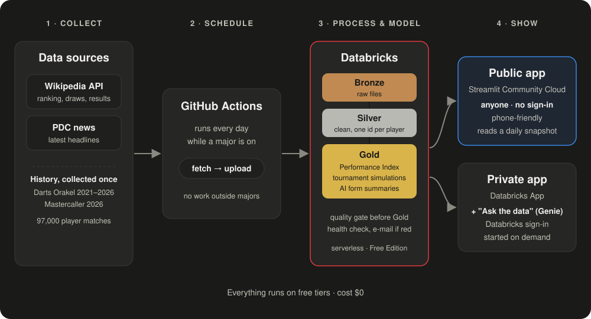

# Darts Performance Analyzer

A data app that rates every top PDC darts player and predicts their matches and tournaments.

### **▶ [Open the app](https://darts-performance-analyzer.streamlit.app)**

No sign-in needed, works on a phone. Updated every night while a major is being played.

## What it answers

| Question | Answer in the app |
|---|---|
| How strong is a player? | **Performance Index**, 0–10. 5 is an average top-32 player, 7 wins 70 % of matches against one. |
| Who wins this match? | Head-to-head chance from two players' PIs, adjusted to the match length. |
| Who wins the tournament? | Each player's chance to reach every round, from 10,000 simulations of the draw. |

It works: the PI predicts winners better than the official PDC ranking, and in 11 past majors the model's
favourite won 70 % of 451 matches.

## How it works

1. **Collect.** Results, rankings and news come from official sources (Wikipedia API, PDC news). Five years of
   history were loaded once at the start.
2. **Schedule.** GitHub Actions checks every night whether a major is on, and only then fetches new data.
3. **Process and model.** Databricks cleans the data in three layers (bronze, silver, gold), checks its quality,
   recalculates the index, simulates the tournaments and writes short AI summaries of each player's form.
4. **Show.** A public Streamlit app for everyone, and a private Databricks app that can also answer questions in
   plain English.

Built with Python, Databricks (Free Edition), Streamlit and GitHub Actions. Running cost: $0.

## Repository

| Folder | Contents |
|---|---|
| `app/` | The app (pages, charts) |
| `ingestion/` | Data collection |
| `src/` | Data processing in Databricks and the model |
| `config/` | Tournaments, AI model, Genie settings |
| `.github/workflows/` | Daily refresh and publishing |
| `docs/` | Methodology and maintenance |

## More

- **[Methodology](docs/METHODOLOGY.md):** how the index and the predictions are made and tested.
- **[Maintenance](docs/MAINTENANCE.md):** where to find things, how to start the private app, what to do when
  something breaks.

Data: Wikipedia and Wikidata (CC BY-SA), PDC; history from Darts Orakel and Mastercaller. Non-commercial project.
Licence: MIT.
